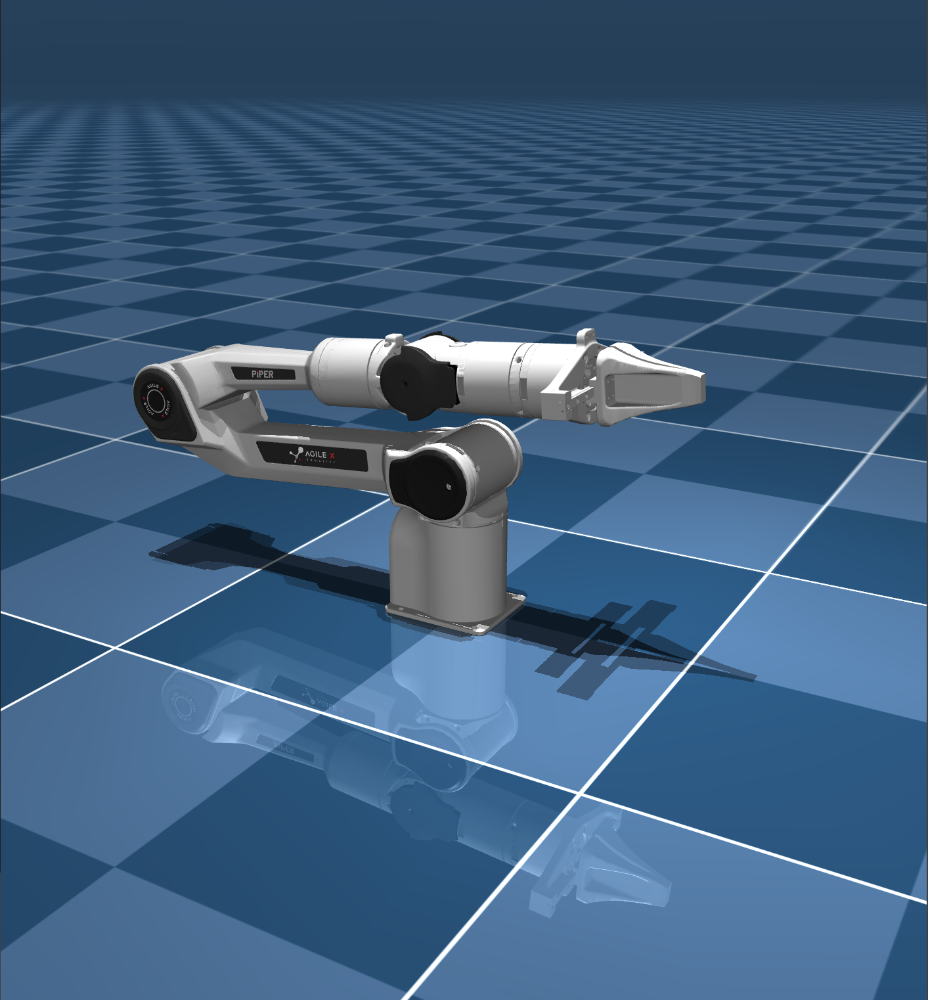

<div align="center">
  <h1>Agilex_Mujoco</h1>
  <table>
    <tr>
      <td align="center">
        <a href="https://global.agilex.ai/products/piper">
          
        </a>
        <br />
        <sub><strong>AgileX PiPER</strong></sub>
      </td>
      <td align="center">
        <a href="https://global.agilex.ai/products/nero">
          
        </a>
        <br />
        <sub><strong>AgileX NERO</strong></sub>
      </td>
    </tr>
  </table>
    <p>
      <strong><kbd>中文</kbd></strong>
      <a href="./README_EN.md"><kbd>English</kbd></a>
    </p>
</div>

# AgileX MuJoCo 仿真基座描述
本项目是AgileX机械臂系列的MuJoCo仿真基座，会伴随项目的不断开发逐步兼容ROS2控制、SDK控制、强化学习控制，完成sim2sim的顺利过渡，最后完成sim2real。

# TODO

- [x] 基础环境构建，支持 Piper 机械臂
- [x] 对基础环境进行重构，提供一个更简洁的仿真环境基座
- [ ] 添加python版本仿真环境基座
- [ ] 添加 Agilex Nero 机械臂支持
- [ ] 完成ros2功能模块控制
- [ ] 添加agilex sdk控制集成
- [ ] 推进强化学习部署测试
- [ ] 推进视觉抓取测试
- [ ] 推进各类 VA 的部署测试
- [ ] 推进各类 VLA 的部署测试

# 快速开始
## 编译agilex_arm_mujoco
```bash
git clone https://github.com/yanyuze1/agilex_arm_mujoco.git
cd agilex_arm_mujoco
mkdir build && cd build
cmake ..
make -j4
```
## 运行agilex_arm_mujoco
```bash
./agilex_mujoco -r piper -s scene.xml
```
此时运行成功，会启动一个MuJoCo仿真环境，并显示Piper机械臂在仿真环境当中。

# 参考
- https://github.com/unitreerobotics/unitree_mujoco
